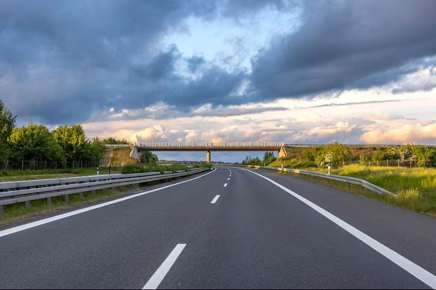
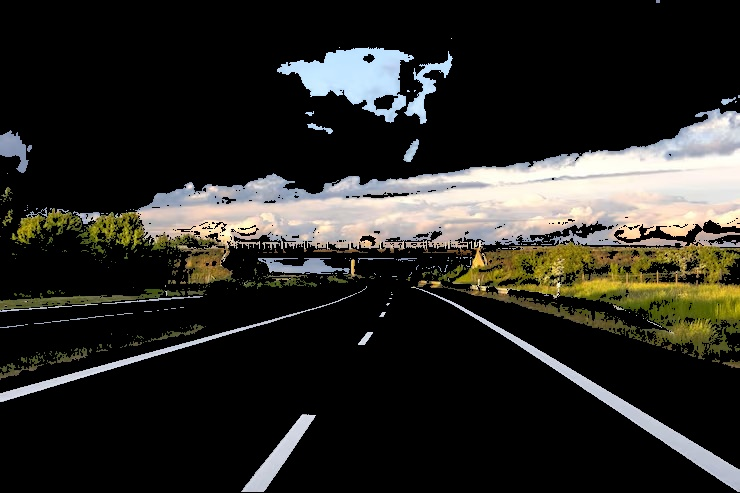
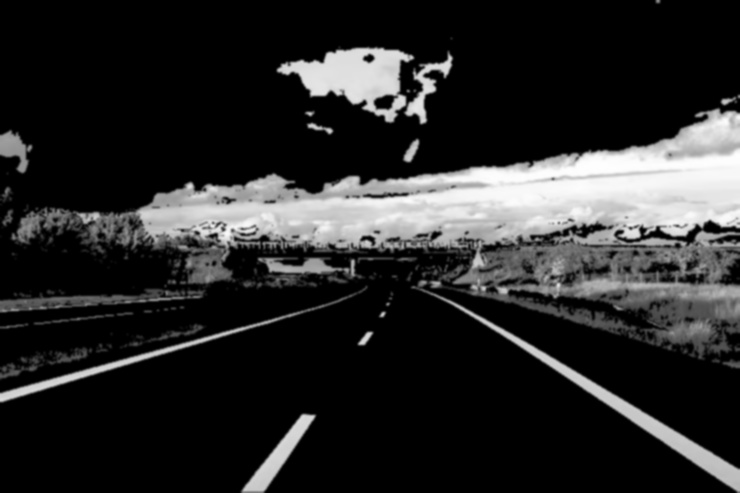
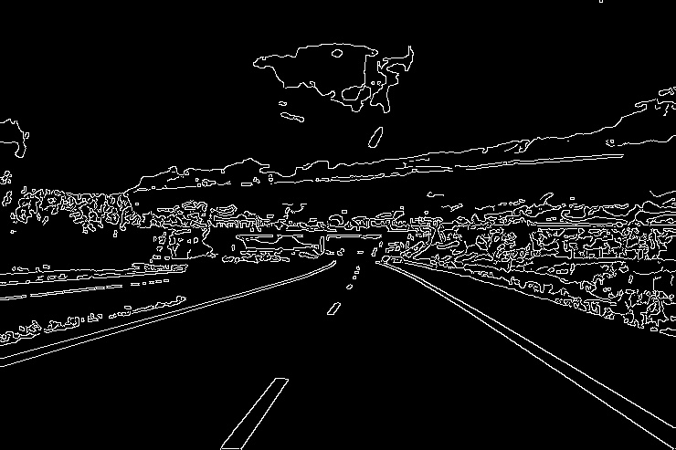
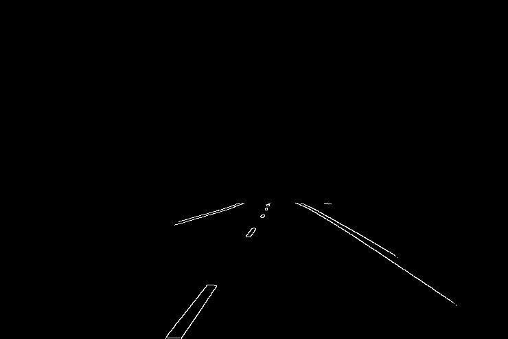

# Lane Detection using OpenCV

A 5-step classical computer vision pipeline in Python to detect and extract road lane boundaries from front-facing dashcam imagery (`road.jpg`).


## Pipeline Overview

1. **Image Loading (`1_original.jpg`)**  
   Reads the input image using `cv2.imread()`. Paths are resolved relative to the script file (`os.path`) so execution succeeds regardless of working directory.

2. **HSV Color Masking (`2_hsv_mask.jpg`)**  
   Converts the input from BGR to the HSV (Hue, Saturation, Value) color space to separate chromaticity from scene illumination:
   - **White Filter:** Hue 0–180, Saturation 0–65, Value 175–255  
   - **Yellow Filter:** Hue 15–40, Saturation 70–255, Value 80–255  
   - Masks are combined via `cv2.bitwise_or()` and applied via `cv2.bitwise_and()` to suppress dark asphalt while preserving painted lane markers under varying lighting conditions.

3. **Grayscale & Gaussian Smoothing (`3_gaussian_blur.jpg`)**  
   Converts the color-filtered result to single-channel grayscale and applies a 5×5 Gaussian blur kernel (`cv2.GaussianBlur`) to attenuate high-frequency asphalt noise and surface texture prior to gradient computation.

4. **Canny Edge Detection (`4_canny_edges.jpg`)**  
   Runs `cv2.Canny()` using dual thresholds ($50$ and $150$, following the standard $1:3$ hysteresis ratio):
   - Gradients $> 150$ are preserved as confirmed edges.
   - Gradients $< 50$ are discarded.
   - Non-Maximum Suppression (NMS) thins detected boundaries to 1-pixel-wide contours.

5. **Region of Interest (ROI) Masking (`5_roi_edges.jpg`)**  
   Constructs a perspective trapezoid matched to road convergence toward the horizon:
   - Vertices: `(0.05 * W, H)`, `(0.40 * W, 0.60 * H)`, `(0.65 * W, 0.60 * H)`, `(0.98 * W, H)`.
   - Applied via `cv2.fillPoly()` and `cv2.bitwise_and()` to isolate the vehicle's driving corridor, eliminating false positives from the sky, distant horizon scenery, and roadside barriers while retaining both left and right lane lines.


## Stage Outputs

| Step 1: Input | Step 2: HSV Mask | Step 3: Gaussian Blur |
| :---: | :---: | :---: |
|  |  |  |

| Step 4: Canny Edges | Step 5: ROI Masked Result |
| :---: | :---: |
|  |  |

---

## Directory Structure

```text
├── road.jpg              # Input dashcam image
├── lane_detector.py      # Main pipeline script
├── 1_original.jpg        # Step 1 output
├── 2_hsv_mask.jpg        # Step 2 output
├── 3_gaussian_blur.jpg   # Step 3 output
├── 4_canny_edges.jpg     # Step 4 output
├── 5_roi_edges.jpg       # Step 5 output
└── README.md